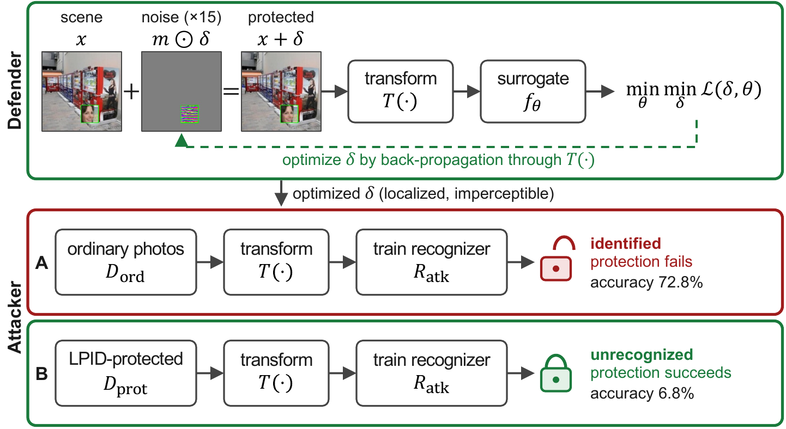
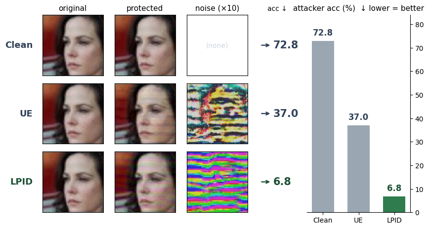

# lpid-face-protect

Imperceptible protection for face photos: even if the images are scraped and trained on without consent, a recognition model cannot identify the person. Public implementation of the ACCV paper **LPID**.




Existing unlearnable examples add protective noise across the full-resolution image. But a real face-recognition attacker runs **detect → crop → resize** before training. In that pipeline, noise outside the face box is discarded by the crop and high-frequency noise is wiped out by resize interpolation — so prior methods (UE/REM/TUE/LSP) collapse, and the attacker recovers 37–74% accuracy on identities unseen at protection time.

LPID confines the protective noise to the face box the attacker will crop, and implements that crop+resize as a **differentiable** operation so the optimization runs *through* the transform. Because the loss gradient after the transform backpropagates into the noise, optimization concentrates energy in the **low-frequency band that survives resizing**.



## Results

Recovery accuracy of a from-scratch attacker on identities unseen at protection time (lower = better protection). Figures are among the methods compared in the paper.

| Method | Recovery accuracy |
|---|---|
| Prior per-sample UE (UE/REM/TUE/LSP) | 37–74% (collapse) |
| Generative SOTA (Segue) | 17% |
| **LPID** | ~5–7% (chance level) |

## Usage

```bash
pip install -r requirements.txt
python3 protect.py --self-test
python3 protect.py --input ./my_photos --output ./protected   # per-identity subfolders, >= 2 identities
```

Outputs are written as lossless PNG (re-saving as JPEG weakens the protection). Full arguments and an algorithm summary are in `docs/program-manual.md`.

## Reproduction scope

This repository provides the protection tool (`protect.py`, 406 lines) and the method. It does not include the full paper benchmark pipeline (surrogate training → attacker from-scratch training → evaluation) or the raw results and checkpoints (produced in the author's training environment). Face datasets follow their respective distribution licenses and are not redistributed. See `DATA_ETHICS.md`.

## Paper

The method is described in the ACCV paper. (Full bibliographic details will be updated once the proceedings are finalized.)

## License

MIT (`LICENSE`). Ethical and responsible use: `DATA_ETHICS.md`.
